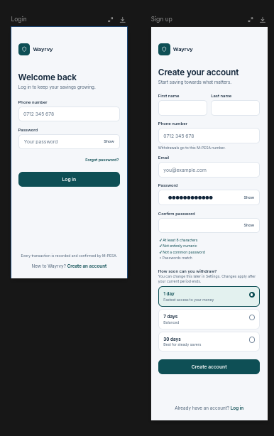
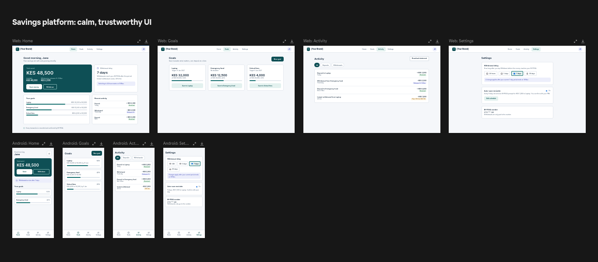

<div align="center">

# Wayrvy

**A commitment savings platform that helps people save with discipline.**

Deposit with M-PESA, set savings goals, and choose how long you must wait before withdrawing.


</div>

---

## Overview

Most people don't struggle to start saving. They struggle to **leave the money alone**. Wayrvy tackles this with intentional friction: when you sign up, you choose a withdrawal waiting period (24 hours, 7 days, or 30 days). When you withdraw, the money is released only after that period, and withdrawing early costs a penalty.

This repository contains the **Django REST API** and the **React web app**. A native Android client is built separately and consumes the same API.

> **Status:** Active development. Payments currently run against the Safaricom Daraja sandbox.

## Screenshots

### Login and signup



### Web and Android app



## Features

### Savings

- Deposit via **M-PESA STK Push** using the Safaricom Daraja API
- **Savings goals:** create, edit, and archive goals; each deposit is assigned to a goal
- A default goal is created automatically at signup
- **Delayed withdrawals:** choose a 24-hour, 7-day, or 30-day waiting period
- Changing the withdrawal period applies only **after the current period ends**
- **Early-withdrawal penalty** for users who choose to withdraw immediately
- Dashboard overview of total savings, available balance, and pending withdrawals
- Transaction history for deposits and withdrawals
- Transactions are recorded and confirmed by M-PESA

### Accounts and security

- Custom user model with **phone number login**, normalized to `254XXXXXXXXX`
- UUID primary keys
- **JWT authentication** (SimpleJWT) for web and mobile clients
  - Web refresh token stored in an **httpOnly cookie**
  - Mobile refresh token returned in the response body
  - Refresh-token blacklisting on logout
- **Password re-confirmation** required before a withdrawal
- Live password checks at signup
- Secrets and credentials loaded from environment variables, never committed

## Design

The interface is built around **trust, calm, and reliability**—qualities people want from an app that holds their money.

- Calm teal palette and Inter typeface
- Clear transaction and withdrawal status labels
- Responsive layout with desktop navigation and mobile bottom tabs
- Plain-language explanations of withdrawal rules and settings
- Shared design language between the web app and Android client

## Tech stack

| Layer | Technology |
|---|---|
| Backend | Python, Django, Django REST Framework, SimpleJWT |
| Database | PostgreSQL |
| Payments | Safaricom Daraja API (STK Push) |
| Frontend | React, TypeScript, Vite, Tailwind CSS |
| Tooling | Git, ESLint, Linux (Fedora) |

## Architecture

```text
┌──────────────┐        ┌──────────────────────┐        ┌────────────┐
│  React web   │ ─────► │   Django REST API    │ ─────► │ PostgreSQL │
│  Android app │  JWT   │  accounts · wallet   │        └────────────┘
└──────────────┘        └──────────┬───────────┘
                                   │ STK Push / callbacks
                                   ▼
                          ┌──────────────────┐
                          │ Safaricom Daraja │
                          └──────────────────┘
```

- **`accounts`**: custom user model, signup/login, token handling
- **`wallet`**: goals, transactions, payment references, M-PESA integration, and withdrawal release command

## Project structure

```text
Wayrvy/
├── api/                    # Django backend
│   ├── accounts/           # Users and authentication
│   ├── wallet/             # Goals, transactions, Daraja integration
│   ├── config/             # Settings, URLs, ASGI/WSGI
│   └── manage.py
├── docs/                   # Project screenshots
│   ├── app.png
│   └── authentication.png
└── web/                    # React + TypeScript frontend
    └── src/
        ├── components/     # UI and feature components
        ├── pages/          # Login, signup, dashboard, goals, activity, settings
        ├── lib/            # API client and helpers
        ├── store/          # Client-side auth state
        └── routes/         # Protected routes
```

## Getting started

### Prerequisites

- Python 3.12+
- Node.js 20+
- PostgreSQL
- A Safaricom [Daraja](https://developer.safaricom.co.ke) sandbox account for STK Push

### 1. Clone the repository

```bash
git clone https://github.com/macharianelson2024-art/Wayrvy.git
cd Wayrvy
```

### 2. Set up the backend

```bash
cd api
python -m venv venv
source venv/bin/activate
pip install -r requirements.txt
```

Create a PostgreSQL database, then create `api/.env`:

```env
SECRET_KEY=your-generated-secret-key
DEBUG=True

DB_NAME=wayrvy
DB_USER=your_db_user
DB_PASSWORD=your_db_password
DB_HOST=localhost
DB_PORT=5432

# Daraja sandbox credentials
DARAJA_CONSUMER_KEY=
DARAJA_CONSUMER_SECRET=
DARAJA_PASSKEY=
DARAJA_SHORTCODE=
DARAJA_CALLBACK_URL=
DARAJA_STK_PUSH_URL=
DARAJA_OAUTH_URL=
```

Generate a Django secret key:

```bash
python -c "from django.core.management.utils import get_random_secret_key; print(get_random_secret_key())"
```

Run migrations and start the API:

```bash
python manage.py migrate
python manage.py createsuperuser
python manage.py runserver
```

The API is available at `http://localhost:8000`.

### 3. Set up the frontend

Open a new terminal from the project root and run:

```bash
cd web
npm install
npm run dev
```

The web app is available at `http://localhost:5173` and communicates with the API through the Vite `/api` development proxy.

## Releasing due withdrawals

Withdrawals are released by a Django management command. Run it manually or schedule it with cron:

```bash
cd api
python manage.py release_withdrawals
```

## M-PESA callbacks in development

Daraja must be able to reach your callback URL over the public internet. During development, expose your local server with a tunnel (such as ngrok) and set `DARAJA_CALLBACK_URL` to the resulting public URL.

## Roadmap

- [ ] Recurring M-PESA auto-save reminders
- [ ] Goal target dates and progress toward deadlines
- [ ] Downloadable account statements
- [ ] Notifications for deposits and withdrawal releases
- [ ] Phone ownership verification
- [ ] B2C payouts for withdrawals
- [ ] Background processing for scheduled releases
- [ ] Signup throttling and cleanup of unverified accounts
- [ ] Production deployment and CI
- [ ] Native Android app (built separately against this API)

## Author

**Nelson Macharia** — Computer Science student and full-stack developer.

GitHub: [@macharianelson2024-art](https://github.com/macharianelson2024-art)
